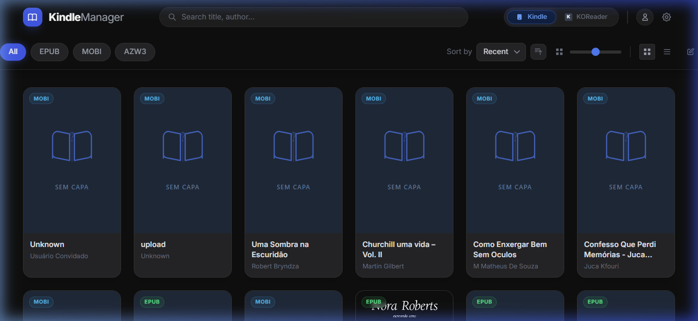
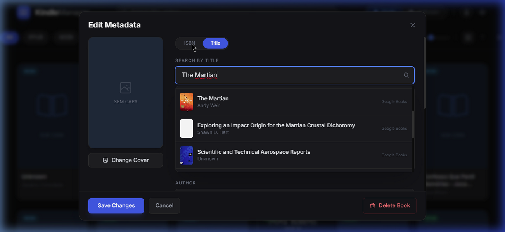

<p align="center">
  
</p>

<h1 align="center">📚 Calibre Jr.</h1>

<p align="center">
  <strong>A modern, self-hosted ebook library manager for Kindle & KOReader</strong>
</p>

<p align="center">
  
  
  
  
  
</p>

---

## ✨ Features

### 📖 Library Management
- **Multi-format support** — EPUB, MOBI, AZW3, PDF, FB2, CBZ
- **Auto-scan & watchdog** — Monitors your ebook folder for new files in real-time
- **Metadata enrichment** — Search Google Books & OpenLibrary by title or ISBN
- **Cover extraction** — Automatic cover art from ebook files or online sources
- **Smart duplicate scanner** — Detects duplicates by MD5 hash and normalized metadata
- **Auto-renamer** — Batch rename files to `Author - Title.ext` format
- **Format filter pills** — Quick filter by EPUB, MOBI, AZW3
- **Grid & List views** — Adjustable zoom slider with multiple layouts

### 📱 Device Integration
- **Kindle detection** — Auto-detects Kindle USB drives
- **KOReader support** — Detects KOReader installations on connected devices
- **Send to device** — One-click file transfer with real-time progress streaming
- **Batch operations** — Multi-select books for bulk send or delete

### 📕 Built-in Web Reader
- **foliate-js** powered — Reads EPUB, MOBI, AZW3, PDF, FB2, CBZ directly in the browser
- **Reading themes** — Dark, Light, Sepia modes
- **Font controls** — Adjustable font size (70%–200%)
- **Reading modes** — Paginated (with animation) or continuous scroll
- **Table of Contents** — Slide-in sidebar with clickable chapters
- **Progress tracking** — Auto-saves reading position per book per profile

### 🔍 Metadata Search
- **Multi-source** — Parallel search across Google Books + OpenLibrary
- **ISBN support** — Detects ISBN-10/13 and uses specialized API endpoints
- **Cover preview** — Live preview updates when selecting search results
- **Tag chips** — Add/remove tags with visual chip interface

### 🎨 UI/UX
- **Modern dark UI** — Glassmorphism effects, smooth animations
- **Multiple themes** — Dark, Light, Pink, Sepia 
- **Edit Metadata modal** — 2-column layout with cover preview, search, and inline editing
- **Contextual menus** — Right-click actions: Read, Send, Edit, Download, Delete
- **Responsive design** — Works on desktop and tablet browsers

---

## 🏗️ Architecture

```
app/
├── main.py                  # FastAPI app, startup/shutdown, routes
├── core/
│   ├── config.py            # Paths, settings, constants
│   ├── database.py          # SQLite init, migrations, WAL mode
│   └── events.py            # SSE event broadcasting
├── models/
│   └── schemas.py           # Pydantic models
├── services/
│   ├── book_service.py      # Scanning, metadata extraction, threading
│   ├── metadata_service.py  # Google Books + OpenLibrary parallel search
│   ├── device_service.py    # Kindle/KOReader USB detection
│   └── watchdog_service.py  # File system watcher
└── api/routes/
    ├── books.py             # CRUD, send, duplicates, auto-rename
    ├── metadata.py          # Search & cover download
    ├── events.py            # SSE stream
    └── misc.py              # Settings, profiles, reading progress

templates/
├── index.html               # Dashboard SPA (TailwindCSS)
└── reader.html              # Web reader (foliate-js)
```

---

## 🚀 Quick Start

### Prerequisites
- Python 3.10+
- pip

### Installation

```bash
# Clone the repository
git clone https://github.com/felyk69/Calibrinho.git
cd Calibrinho

# Create virtual environment
python -m venv venv

# Activate (Windows)
.\venv\Scripts\activate
# Activate (macOS/Linux)
source venv/bin/activate

# Install dependencies
pip install -r requirements.txt
```

### Running

```bash
uvicorn app.main:app --reload
```

Open **http://localhost:8000** in your browser.

### First-time Setup

1. Click the ⚙️ **Settings** icon in the header
2. Set your ebook folder path (e.g., `C:/Users/you/Ebooks`)
3. Click **Save** — the scanner will index your library automatically
4. Plug in your Kindle/KOReader device to enable sending

---

## 📸 Screenshots

<table>
  <tr>
    <td width="50%"></td>
    <td width="50%"></td>
  </tr>
  <tr>
    <td align="center"><em>Library Dashboard</em></td>
    <td align="center"><em>Edit Metadata Modal</em></td>
  </tr>
</table>

---

## 🛠️ Tech Stack

| Layer | Technology |
|-------|-----------|
| **Backend** | Python, FastAPI, Uvicorn |
| **Database** | SQLite (WAL mode) |
| **Frontend** | HTML, JavaScript, TailwindCSS (CDN) |
| **Templating** | Jinja2 |
| **Reader** | foliate-js (via jsDelivr CDN) |
| **Metadata** | Google Books API, OpenLibrary API |
| **Ebook Parsing** | ebookmeta, PyMuPDF (fitz) |
| **File Watching** | watchdog |
| **Device Detection** | Custom USB drive scanner |

---

## 📋 API Endpoints

| Method | Endpoint | Description |
|--------|----------|-------------|
| `GET` | `/api/books` | List all books |
| `PUT` | `/api/books/{id}` | Update book metadata |
| `POST` | `/api/send` | Send book to Kindle (streamed) |
| `POST` | `/api/delete` | Delete books (trash or permanent) |
| `GET` | `/api/books/duplicates` | Find duplicate books |
| `POST` | `/api/books/auto-rename` | Batch rename all files |
| `GET` | `/api/metadata/search?q=` | Search metadata (Google + OpenLibrary) |
| `GET` | `/api/detect-device` | Detect Kindle/KOReader USB |
| `GET` | `/api/settings` | Get app settings |
| `PUT` | `/api/settings` | Update settings & rescan |
| `GET` | `/api/events` | SSE real-time events stream |
| `GET` | `/reader?id=` | Open book in web reader |

---

## 🗺️ Roadmap

See [ROADMAP.md](ROADMAP.md) for the full development roadmap.

**Completed:**
- ✅ Modular architecture (Controller-Service-Model)
- ✅ Built-in Web Reader (foliate-js)
- ✅ Auto-renamer & duplicate scanner
- ✅ Multi-source metadata search

**Planned:**
- 📡 OPDS server for wireless KOReader downloading
- 📧 Send-to-Kindle via email
- 👥 Multi-profile system
- ⭐ Reading status, ratings & collections
- 🔄 On-the-fly format conversion

---

## 🤝 Contributing

Contributions are welcome! Feel free to open issues or submit pull requests.

---

## 📄 License

This project is licensed under the MIT License.

---

<p align="center">
  Made with ❤️ for ebook enthusiasts who want a <strong>lightweight alternative to Calibre</strong>
</p>
